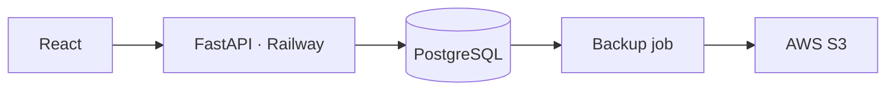

# skillissue.gg — Sekiro

A full-stack web app for recording, assessing, and sharing Sekiro boss victories. Enter your clear conditions, see how the grade was calculated, and compare your record with submissions for the same boss and challenge settings.

**[Open the app](https://skillissue-sekiro-production.up.railway.app/)**

## Features

- **14 bosses:** searchable selection, including separate entries for both Isshin encounters and both Monk encounters.
- **Clear conditions:** healing uses, resurrections, Charmless, Demon Bell, Prosthetic tools, and Combat Arts.
- **Transparent grading:** a provisional resource-use score with an explanation of every deduction.
- **Condition-specific rankings:** separate cohorts for each boss × Charmless × Demon Bell combination; percentiles appear after 20 eligible submissions.
- **Shareable records:** URL-based input sharing and downloadable PNG cards.
- **Responsive UI:** moonlit teal and silver styling, katana/full-moon artwork, and mobile-friendly count controls.
- **Submission safeguards:** server-side validation and scoring, hourly submission limits, duplicate exclusion, and an offline anomaly-detection pipeline.
- **Backup tooling:** a separate PostgreSQL-to-S3 job, checksum manifests, and a restore-verification tool for an empty test database.

Records are self-reported. The application does not collect game telemetry or verify that a boss was defeated.

## Tech stack

| Layer | Technologies |
| --- | --- |
| Frontend | React 19, TypeScript, Vite, CSS, Canvas API |
| API | Python, FastAPI, Pydantic |
| Storage | PostgreSQL; SQLite for local development |
| Data processing | Pandas, NumPy, scikit-learn Isolation Forest |
| Packaging and hosting | Multi-stage Docker build, Railway |
| CI | GitHub Actions: frontend, API, container, and backup checks |
| Backup tooling | PostgreSQL client tools, Boto3, AWS S3 |

## Architecture



FastAPI serves the React build and API from the same Railway service. In local development, Vite runs separately and proxies API requests to FastAPI.

Scores are calculated in the browser. Revealing a result fetches the matching cohort's ranking without saving anything. Records are written to PostgreSQL only when the user clicks **Contribute this clear**, and the API recalculates the score before saving.

Separate jobs handle expired records, anomaly review, and database backups. The anomaly detector reports candidates without changing rankings. The backup job uploads PostgreSQL snapshots and checksum manifests to S3; it must be configured separately from the web service.

## Run locally

Use Node.js 22.12+ within the 22 release line, or Node.js 24, and Python 3.12 or 3.13. Run commands from the repository root unless a step changes directories.

### Install dependencies

```sh
python3 -m venv .venv
source .venv/bin/activate
pip install -r backend/requirements.txt

cd web
npm ci
cd ..
```

On Windows, activate the environment with `.venv\Scripts\activate` instead.

### Development: two terminals

Terminal 1 — API:

```sh
source .venv/bin/activate
cd backend
uvicorn app:app --host 127.0.0.1 --port 8000 --no-proxy-headers
```

Terminal 2 — frontend:

```sh
cd web
npm run dev
```

Open **http://localhost:5173**. Keep both terminals running to submit records and retrieve community rankings. Stop each server with `Ctrl+C`.

### Serve the production build locally

```sh
cd web
npm run build
cd ../backend
uvicorn app:app --host 127.0.0.1 --port 8000 --no-proxy-headers
```

With the Python environment active, open **http://localhost:8000**. Stop any existing server using port 8000 first. This mode does not need Vite; rebuild after frontend changes. FastAPI serves `web/dist/`, not the TypeScript source files.

## Scoring and rankings

```text
score = max(0, 100 - healing_uses × 5 - resurrections × 15)
```

| Grade | Score |
| --- | --- |
| S | 95–100 |
| A | 80–94 |
| B | 60–79 |
| C | 0–59 |

Charmless and Demon Bell do not add points. They define separate ranking cohorts. Prosthetic tools and Combat Arts are displayed on the card without a score penalty.

Scores describe resource use under the site's provisional rules, not overall player skill. They do not normalize boss difficulty, other character stats, or item effects. Zero healing does not imply a no-hit run.

**Reveal** calculates locally and retrieves a read-only ranking. It never inserts a record, and calculation/lookup has no application submission quota. **Contribute this clear** explicitly saves the displayed record. Exact repeats from the same visitor within 24 hours return success without creating another row.

Rankings compare eligible records from the retention window for the same boss × Charmless × Demon Bell settings. At least 20 records are required; otherwise the card displays the current count. The displayed top percentage is `ceil(100 × (number of strictly better records + 1) / cohort size)`, bounded to 1–100. Ties share a rank. This is a record comparison, not a verified or unique-player skill percentile.

## Submission filtering

The API validates types, boss and clear status, and calculates scores independently. The default limit is **60 new contributions per anonymous visitor per hour**. Repeated records and read-only comparisons do not consume that quota. PostgreSQL transaction advisory locks serialize each visitor's duplicate/limit check and insertion; SQLite uses `BEGIN IMMEDIATE`.

A signed HttpOnly cookie supplies a stable anonymous identifier for up to 30 days, independent of proxy IP or user agent. Clearing cookies can bypass this soft limit. Old IP-based keys remain historical records until retention cleanup; there is no identity migration.

`backend/detect.py` groups records by visitor, computes eight behavior features and runs a 300-tree Isolation Forest when at least 30 keys have three submissions each. An outlier plus an explainable signal becomes a **review candidate only**. Running with or without `--dry-run` never changes database flags. Historical ML exclusions remain unchanged pending manual review. Candidates are not evidence of cheating, and synthetic evaluation is not production accuracy.

## Tests and CI

Build the frontend before running the API tests:

```sh
# Repository root; Python virtual environment active
npm --prefix web run build

cd backend
python test_api.py
python simulate.py
python detect.py --dry-run
cd ..

python -m unittest discover -s backup -p 'test_*.py' -v
```

- `test_api.py` uses a temporary SQLite database and checks built assets, source-file exclusion, validation, scoring, duplicate handling, rate limits, and percentile responses.
- `test_postgres.py` runs against an explicitly configured, disposable local PostgreSQL database. It tests persistence, concurrent duplicates, concurrent quota enforcement and read-only cohort queries. CI supplies PostgreSQL 18; no production credentials are used. See [backend test instructions](backend/README.md#tests).
- `simulate.py` evaluates anomaly detection using an isolated synthetic dataset; it does not populate the application database.
- `detect.py --dry-run` reads the configured database and reports candidates without applying flags. Small datasets are skipped.
- Backup tests mock database tools and uploads. They do not establish that real PostgreSQL or S3 access works.

The GitHub Actions workflow checks frontend types/builds, SQLite and PostgreSQL API behavior, both Docker images, and backup/restore safeguards. Check the workflow run for its actual status. Live PostgreSQL connectivity, cloud credentials, and a real restore require separate verification.

## Deployment

The root `Dockerfile` builds React in a Node stage and copies only `web/dist/` into the Python runtime image. FastAPI listens on Railway's `PORT` and exposes `/healthz` for readiness checks.

| Service | Build | Start command | Intended schedule |
| --- | --- | --- | --- |
| Web | `Dockerfile` | Dockerfile CMD | Long-running |
| Maintenance | `Dockerfile` | `sh -c "python cleanup.py && python detect.py"` | Hourly, if configured |
| Backup | `Dockerfile.backup` | `python backup.py` | Daily at 07:00 UTC, if configured |

Each service uses the repository root as its build context. For the backup service, set `RAILWAY_DOCKERFILE_PATH=Dockerfile.backup`. It needs no public domain or HTTP healthcheck. Configure its start command, cron schedule, and restart policy (`Never`) in the service settings.

The `railway*.json` files record intended deployment settings. For new services, use Railway's currently supported configuration mechanism rather than assuming legacy JSON files will be applied. See the [Railway configuration documentation](https://docs.railway.com/config-as-code).

### Web environment

| Variable | Purpose |
| --- | --- |
| `DATABASE_URL` | Required in production; SQLite fallback is local-only |
| `DEVICE_SECRET` | Random HMAC secret, at least 32 characters; required for PostgreSQL/production |
| `WEB_DIR` | Built asset directory; Docker sets `/app/web/dist` |
| `MAX_PER_HOUR` | New contributions per visitor/hour; default `60` |
| `RETENTION_DAYS` | Submission retention; default `90` |
| `APP_ENV` | Set `production` outside Railway to require PostgreSQL |

Environment examples document variable names; `.env` files are not automatically loaded. Keep actual connection strings and credentials out of Git. SQLite records are not automatically migrated when switching to PostgreSQL.

Replicas must share the same PostgreSQL database and DEVICE_SECRET. Submission transactions coordinate through PostgreSQL. Schema initialization is not a migration framework. `/healthz` reports `storage: postgresql` or `sqlite`.

### S3 backup environment

The backup service needs its own `DATABASE_URL`, `BACKUP_S3_BUCKET`, `BACKUP_S3_PREFIX`, `AWS_DEFAULT_REGION`, and AWS credentials. Prefix-scoped IAM upload policy and S3 lifecycle templates are included under `backup/`.

The job creates a custom-format PostgreSQL archive, checks its table-of-contents listing, uploads it using SSE-S3 encryption, and then writes a JSON manifest with its size and SHA-256 checksum. A matching archive and manifest mark a completed upload. `--dry-run` validates configuration only, without contacting PostgreSQL or AWS.

`restore_verify.py` checks archive size/checksum and restores only into an explicitly selected empty test database. It never runs `DROP` or `--clean`. Do not use the production database as a restore-test target. See [BACKUP_SETUP.md](BACKUP_SETUP.md) for scripts and templates; use current Railway service settings for scheduling.

Daily snapshots are not continuous replication or automatic failover. Backup retention, failed-run monitoring, and restore drills must be configured separately. Restoring an old snapshot can reintroduce expired records; reapply cleanup before returning a restored database to service.

## Project structure

```text
.github/workflows/ci.yml   Build, API, container, and backup checks
backend/
  app.py                  FastAPI routes and built frontend hosting
  db.py                   SQLite/PostgreSQL storage and server scoring
  detect.py               Batch anomaly detection
  cleanup.py              Retention cleanup
  simulate.py             Synthetic evaluation
  test_api.py             SQLite API and built-asset integration tests
  test_postgres.py        PostgreSQL persistence and concurrency tests
web/
  src/
    PageChrome.tsx        Header, hero, footer
    ScoreApp.tsx          Draft/record state and submission lifecycle
    BossSelector.tsx      Searchable boss selection
    CountInput.tsx        Bounded count controls
    ResultCard.tsx        Result presentation
    downloadCard.ts       PNG export
    run.ts                Shared-link parsing and record helpers
  scoring.mjs             Boss registry and frontend scoring
  scoring.d.mts           Type declarations for the scoring module
  vite.config.ts          Build configuration and development API proxy
backup/
  backup.py               PostgreSQL snapshot and S3 upload
  restore_verify.py       Empty-target restore verification
  test_*.py               Offline safeguard tests
  requirements.txt        Backup-specific Python dependency
  iam-upload-policy.json  Prefix-scoped upload policy template
  s3-lifecycle.json       Backup expiry template
Dockerfile                Web production image
Dockerfile.backup         Standalone backup job image
```

## Current scope

- Boss-rematch records only; no story-mode normalization or game-account integration.
- Shared links encode editable input values, not verified or immutable database records.
- Social previews use a shared static image; per-record Open Graph images are not implemented.
- No live advertising or analytics trackers are included.
- Privacy notice and retention settings must match the actual hosting and backup setup.

Unofficial fan project. Not affiliated with FromSoftware or Activision.
